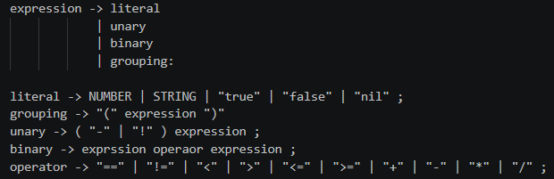
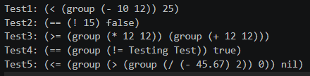

# CIS 343 Scanner Lab 2

Language Name: PLox

## Expression Grammer




## Design choices relative to Lox

PLox retains Lox-style number, string, boolean, and nil literals. Its expression grammar supports unary negation and logical not, arithmetic operators, equality and comparison operators, and grouping. Literal, Unary, Binary, and Grouping nodes store the expression structure, while operator tokens reuse the Token and TokenType classes from Lab 1.

The printer uses Python match/case to select the appropriate behavior for each node class instead of the textbook's Visitor pattern. It recursively prints child expressions and uses parenthesized prefix notation to preserve the tree's hierarchy. Python's True, False, and None values are printed as true, false, and nil to match PLox's literal spellings.

The grammar does not specify operator precedence or associativity. In this lab, expressions are constructed manually, so the AST structure determines how operands are grouped. Parsing and evaluation are outside this implementation's scope.

## Dependency/setup instructions

Python 3.10 or newer is required because the AST printer uses match/case. No third-party packages are required.

Open PowerShell in the repository root (the folder containing src, test, and report). Check the Python version:

```powershell
python --version
```

Run the printer tests from that same directory:

```powershell
$env:PYTHONPATH = "$PWD\src"
python test/lab2/test.py
```

PYTHONPATH allows the test script to import the AST classes, printer, and tokens from src. This setting applies to the current terminal session; set it again when opening a new terminal. A virtual environment is optional; if using one, activate it before running these commands.

The script constructs five hard-coded AST examples and prints one result per line, in test1 through test5 order. Compare these lines with the expected outputs documented for each test. The script does not automatically assert pass/fail results. No source-code input files or scanner execution are needed.

## Testing

All testing is provided in one file and are ran by running this file in the test file path.

Path: test/lab2/test.py

This test.py file runs 5 test, all together they cover all expression classes, literals, all operator types and nested expressions.

Comment: All tests outpted the correct string representations of the tree, 

Hard Coded AST:

Test!:
```python
Binary(
    Grouping(
        Binary(
            Literal(10),
            Token(TokenType.MINUS, "-", None, 1),
            Literal(12),
        )
    ),
    Token(TokenType.LESS, "<", None, 1),
    Literal(25),
)
```

Test2:
```python
Binary(
    Unary(
        Token(TokenType.BANG, "!", None, 1),
        Literal(15),
    ),
    Token(TokenType.EQUAL_EQUAL, "==", None, 1),
    Literal(False),
)
```

Test3:
```python
Binary(
    Grouping(
        Binary(
            Literal(12),
            Token(TokenType.STAR, "*", None, 1),
            Literal(12),
        )
    ),
    Token(TokenType.GREATER_EQUAL, ">=", None, 1),
    Grouping(
        Binary(
            Literal(12),
            Token(TokenType.PLUS, "+", None, 1),
            Literal(12),
        )
    ),
)
```

Test4:
```python
Binary(
    Grouping(
        Binary(
            Literal("Testing")
            Token(TokenType.BANG_EQUAL, "!=", None, 1)
            Literal("Test")
        )
    ),
    Token(TokenType.EQUAL_EQUAL, "==", None, 1),
    Literal(True),
)
```

Test5:
```python
Binary(
    Grouping(
        Binary(
            Grouping(
                Binary(
                    Unary(
                        Token(TokenType.MINUS, "-", None, 1)
                        Literal(45.67)
                    ),
                    Token(TokenType.SLASH, "/", None, 1),
                    Literal(2),
                )
            ),
            Token(TokenType.GREATER, ">", None, 1),
            Literal(0),
        )
    ),
    Token(TokenType.LESS_EQUAL, "<=", None, 1),
    Literal(None),
)
```

### Test purposes and results

The expected and actual strings below omit the Test1 through Test5 labels added by the test runner. Results were manually compared after running test/lab2/test.py.

| Test | Purpose | Expected output | Actual output | Result |
|---|---|---|---|---|
| 1 | Verify number literals, binary subtraction and less-than, and a grouped expression nested inside another binary expression. | `(< (group (- 10 12)) 25)` | `(< (group (- 10 12)) 25)` | Pass - actual output matches expected output. |
| 2 | Verify unary logical not, binary equality, a number literal, and the false boolean literal. | `(== (! 15) false)` | `(== (! 15) false)` | Pass - actual output matches expected output. |
| 3 | Verify multiplication, addition, greater-than-or-equal, and grouping on both sides of a binary expression. | `(>= (group (* 12 12)) (group (+ 12 12)))` | `(>= (group (* 12 12)) (group (+ 12 12)))` | Pass - actual output matches expected output. |
| 4 | Verify string literals, inequality, equality, the true boolean literal, and a grouped comparison. | `(== (group (!= Testing Test)) true)` | `(== (group (!= Testing Test)) true)` | Pass - actual output matches expected output. |
| 5 | Verify unary minus, division, greater-than, less-than-or-equal, decimal and nil literals, and multiple levels of nesting. | `(<= (group (> (group (/ (- 45.67) 2)) 0)) nil)` | `(<= (group (> (group (/ (- 45.67) 2)) 0)) nil)` | Pass - actual output matches expected output. |

These tests verify AST representation and printing, not whether the expressions would be valid to evaluate. For example, Test 5 deliberately includes a comparison with nil to exercise its printed representation.

Actual test-run screenshot:



## Limitations

- The AST classes do not validate operand types. They can represent expressions such as a comparison with nil, even if execution would reject it.
- String literals print without quotation marks, so a string such as "true" looks the same as the boolean true.
- Tests print results for manual comparison rather than automatically checking expected output.


